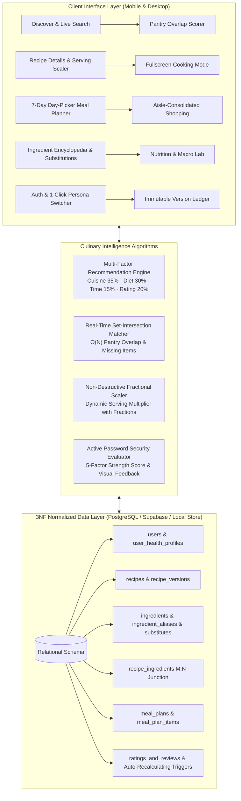

<p align="center">
  
</p>

<h1 align="center">RecipeVault</h1>

<p align="center">
  <strong>A Production-Grade Culinary Intelligence & 3NF Relational Recipe Management System</strong><br />
  <em>Where rigorous database engineering meets the warm, tactile aesthetic of a handwritten family cookbook.</em>
</p>

<p align="center">
  <a href="#-academic--engineering-context"></a>
  <a href="#-tech-stack--architecture"></a>
  <a href="#-tech-stack--architecture"></a>
  <a href="#-cloud-deployment--vercel-readiness"></a>
  <a href="#-automated-testing--verification"></a>
</p>

---

## 👨‍🍳 Academic & Engineering Context

- **Academic Focus:** Relational Database Management Systems (DBMS), Advanced Normalization (3NF/BCNF), Relational Query Optimization, and Modern Responsive Full-Stack Engineering.
- **Engineering Authors:**
  - **Neeraj K** (`24BCE2393`) — Relational Schema Design, Foreign Keys, SQL Triggers, Analytical Views & Database Optimization.
  - **Eric Titus** (`24BCE0096`) — Full-Stack Interface Engineering, Mobile App Architecture, "Warm Pantry" Design System & Culinary Math Algorithms.

---

## 🍳 System Highlights & System Architecture



---

## 📱 Mobile-First Native Experience & Desktop Preservation

RecipeVault delivers a **high-craft native mobile app experience** on smartphones while keeping the expanded desktop dashboard 100% intact:

| Interface Section | Mobile Experience (≤ 640px) | Desktop / Laptop Experience (≥ 1024px) |
| :--- | :--- | :--- |
| **Discover Feed** | **Snappy 2-Column Grid (`grid-cols-2`)**: 4–6 recipes fit per screen height with 4:3 food thumbnails and tactile tuck-in bookmark buttons. | Expanded 3-column editorial grid with full recipe descriptions and hover elevations. |
| **App Navigation** | **5-Tab Fixed Bottom Dock**: Quick 1-tap switching between Discover, Cookbook, Add (+), Planner, and Pantry. | Fixed 250px left sidebar with collapsible mode, quick navigation, and command palette. |
| **Meal Planner** | **Interactive 7-Day Day-Picker**: Horizontal date strip focusing on that day's 3 meals (*Breakfast, Lunch, Dinner*), eliminating 21-card vertical scrolling. | Full 7-column calendar matrix view with drag-and-drop meal slots. |
| **Filter System** | **Touch Bottom-Sheet Modal**: Native dialog with touch chips for Diets, Cuisines, Prep Time limits, and 1-tap Pantry Match filter. | Inline collapsible multi-column filter bar. |
| **Pantry Shelf** | **Horizontal 1-Row Scrolling Strip**: Live stock counts, quick status pills, and compact expiry warnings. | Multi-column categorized pantry pantry shelves with batch inventory controls. |
| **Authentication** | **Full-Width Touch Cards**: Dedicated Sign Up tab, live 4-tier strong password meter, 3-step account recovery, and large 36px avatar persona switchers with 0px overflow. | Elegant centered modal with ambient background glow and floating atmosphere control. |

---

## 🌿 The "Warm Pantry" Design System

RecipeVault is built on the philosophy of a warm, digital kitchen shelf. It rejects cold, clinical dashboards in favor of crafted typography, tactile animations, and ambient day-night modes:

| Token Name | Hex Code | Visual Application |
| :--- | :--- | :--- |
| **Cream Base** | `#FAF6F0` | Default page background — warm artisan ivory |
| **Card White** | `#FFFDF9` | Elevation surfaces with 16–24px border radius |
| **Espresso Ink** | `#2C231B` | High-contrast typography, crisp headings, and labels |
| **Terracotta Clay** | `#C4633F` | Primary action buttons, bookmarks, active chips |
| **Muted Sage** | `#7C9070` | Pantry stock indicators, vegetarian tags, health stats |
| **Honey Amber** | `#D9A441` | Star ratings, cooking highlights, simmer embers |
| **Linen Border** | `#E9DFD2` | Soft dividers doing more work than harsh drop shadows |

### ☀️ Circadian Rhythm Atmospheres
RecipeVault features 3 automated or manual time-based visual environments:
1. **Morning Dawn (`6 AM – 12 PM`)**: Bright morning sun (`#F4F8F6`), fresh garden mint (`#389868`), clean marble surfaces.
2. **Sunset Pantry (`12 PM – 7 PM`)**: Cozy golden hour in an artisan pantry, warm clay pots, dried herbs, amber honey.
3. **Night & Rest (`7 PM – 6 AM`)**: Deep twilight slate (`#0D121B`), anti-glare moonlit silver text (`#E3E9F2`), cozy warm hearth glow.

---

## 🗄️ Relational Database Engineering (3NF Normalized)

The project includes production-grade PostgreSQL scripts located in `src/db/`:

- [`src/db/schema.sql`](src/db/schema.sql): PostgreSQL 3NF DDL (Tables, Foreign Keys, Indexes, Triggers, Views).
- [`src/db/seed.sql`](src/db/seed.sql): Canonical culinary seed data, authentic versions, and multi-persona ratings.

### Relational Schema Tables
- **`users`**: Cook identity, culinary role, skill level (`Beginner`, `Home Cook`, `Seasoned Chef`), target prep time.
- **`recipes`**: Canonical recipe records with prep time, cook time, difficulty, visibility, servings, diet tags.
- **`recipe_versions`**: Immutable revision ledger with commit summaries, author IDs, and 1-click rollback.
- **`ingredients`**: Master botanical & culinary dictionary with classifications, flavor profiles, and shelf life.
- **`recipe_ingredients`**: $M:N$ junction table mapping quantities, fractional units, and prep states (*finely diced*).
- **`ingredient_aliases`**: $1:N$ regional and linguistic synonyms (*Garbanzo beans / Ceci / Kabuli chana*).
- **`ingredient_substitutes`**: Self-referencing relationship mapping culinary replacements with substitution ratios.
- **`meal_plans` & `meal_plan_items`**: 7-day schedule with serving multipliers.
- **`ratings_and_reviews`**: Verified cook reviews with auto-recalculated recipe ratings via PostgreSQL trigger `trg_recipe_review_aggregate`.
- **`clinical_conditions` & `user_health_profiles`**: Health conditions (Type 2 Diabetes, PCOS, Hypertension/DASH, GERD, Celiac) and clinical ingredient substitutions.

### Analytical Database Views
- **`v_diabetic_pcos_recommendations`**: Dynamic Net Carbs calculation ($Carbs - Fiber$) paired with glycemic suitability.
- **`v_pantry_match_helper`**: Set-intersection query between stocked ingredients and recipe requirements.
- **`v_healthy_recipe_summary`**: Aggregate nutrition, glycemic profiles, and condition suitability tags.
- **`v_active_cook_profiles`**: Consolidated cook personas and dietary preferences.
- **`v_top_rated_recipes`**: Community ratings and verified cook reviews.

---

## 🚀 Key Interactive Capabilities

| Feature | Description | Engineering Implementation |
| :--- | :--- | :--- |
| **Dedicated Sign Up & Registration** | Dedicated account creation portal for brand-new cooks with culinary role specialization. | Dynamic state machine (`/login?mode=register`) with role selectors and session persistence. |
| **Active Strong Password Feature** | Real-time password strength assessment measuring 5 criteria with visual color meter. | Live regex evaluation with 4-tier colored progress bar and interactive requirement checkmarks. |
| **Interactive Account Recovery** | Complete 3-step guided password recovery flow with 1-click demo code filler (`784912`). | Stepwise verification flow with live password reset directly updating the database store. |
| **Pantry Overlap Intelligence** | "Cook With What You Have" real-time recipe matching. | Set-intersection overlap algorithm calculating missing vs. stocked items in $O(N)$ time. |
| **Non-Destructive Serving Scaler** | Scale from 1 to 24 servings dynamically. | Pure mathematical function formatting culinary fractions (`1/2`, `1 1/4`) without mutating records. |
| **Fullscreen Cooking Mode** | Distraction-free hands-on counter view. | Large typography, step progress indicators, built-in kitchen timers, and counter tips. |
| **Aisle-Consolidated Shopping** | Aggregates all ingredients across planned meals with grocery budget. | Categorizes by supermarket aisle with thermal grocery slip styling and 1-tap WhatsApp export. |
| **Recipe Version Control** | Git-style immutable revision snapshots. | Snapshot diffing, version commit summaries, and 1-click rollback restoration. |
| **Artisan Wooden Ladle Cursor** | Custom teak/cherry ladle with grain inlays and brass band. | Hardware-accelerated `requestAnimationFrame` tracking with tactile downward strike on click. |
| **1-Click Persona Fast-Switch** | Instant toggle between Eric Titus, Chef Marcus, and Dr. Aris. | High-visibility mobile cards with 36px avatars for frictionless grading and viva evaluation. |

---

## ☁️ Cloud Deployment & Vercel Readiness

RecipeVault is configured for production serverless deployment on **Vercel** utilizing the **Nitro Vercel Preset** and the **Vercel Build Output API v3**:

- **`vite.config.ts`**: Automatically sets `nitro: { preset: "vercel" }` when building in Vercel's cloud environment (`process.env.VERCEL`).
- **`vercel.json`**: Configures `NITRO_PRESET=vercel npm run build` to compile the app directly into `.vercel/output/` (Node.js serverless functions in `.vercel/output/functions` and static assets in `.vercel/output/static`).
- **Zero Hydration Mismatch**: All client-side storage APIs (`localStorage`, `window`) are safely guarded with SSR checks to guarantee immediate React hydration and working interactive buttons on deployed URLs.

---

## 🛠️ Automated Testing & Verification

RecipeVault maintains a strict automated test suite covering mathematical algorithms, serving scalers, recommendation logic, and routing:

```bash
# Run unit and integration tests
npm test
```

```
✓ src/test/culinary-engine.test.ts (13 tests)
✓ src/test/app-routing.test.tsx (1 test)

Test Files  2 passed (2)
     Tests  14 passed (14)
  Duration  4.81s
```

### Local Development Setup

```bash
# 1. Clone repository
git clone https://github.com/your-username/recipevault.git
cd recipevault

# 2. Install dependencies
npm install

# 3. Start local development server
npm run dev
# -> Opens http://localhost:8080 (or port 8081)

# 4. Build for Vercel production
npm run build:vercel
# -> Compiles into .vercel/output/ with 0 errors
```

---

## 📂 Repository Layout

```
recipevault/
├── public/                    # Favicons (SVG, PNG, ICO) & robots.txt
├── src/
│   ├── assets/                # High-resolution food photography
│   ├── components/            # Reusable Warm Pantry UI components
│   │   ├── recipe-vault-logo.tsx      # Vector SVG branding component
│   │   ├── wooden-ladle-cursor.tsx    # Animated wooden ladle mouse pointer
│   │   ├── theme-slider.tsx           # Morning / Sunset / Night mode toggle
│   │   ├── recipe-card.tsx            # Recipe card with tuck animation & badges
│   │   ├── semantic-ingredient-picker.tsx # Auto-suggest ingredient selector
│   │   ├── cooking-mode-modal.tsx     # Fullscreen hands-on cooking view
│   │   ├── vault-provider.tsx         # Normalized state, auth & localStorage engine
│   │   └── vault-shell.tsx            # Persistent sidebar & autolayout navigation
│   ├── db/
│   │   ├── schema.sql                 # Complete PostgreSQL 3NF DDL
│   │   └── seed.sql                   # Relational seed dataset
│   ├── lib/
│   │   ├── culinary-engine.ts         # Math algorithms: scaling, overlap, recommendation
│   │   ├── recipes.ts                 # Master recipe dataset & types
│   │   └── metadata.ts                # Page titles & SEO metadata
│   ├── routes/
│   │   ├── __root.tsx                 # Root layout with fonts, ladle cursor & toaster
│   │   ├── index.tsx                  # Discover feed, 2-column mobile grid, search
│   │   ├── login.tsx                  # Auth portal, registration, password meter & recovery
│   │   ├── create.tsx                 # Recipe creator & immutable version commits
│   │   ├── cookbook.tsx               # Personal collections & saved recipe shelves
│   │   ├── planner.tsx                # 7-day meal matrix & consolidated shopping list
│   │   ├── ingredients.tsx            # Semantic ingredient encyclopedia & substitutes
│   │   ├── nutrition.tsx              # Nutrition lab, calorie dials & macro breakdown
│   │   ├── profile.tsx                # Personal taste, allergen & security controls
│   │   ├── settings.tsx               # Circadian rhythm schedule & database state
│   │   └── recipe/$id.tsx             # Serving scaler, cooking mode & revision rollback
│   └── test/
│       ├── culinary-engine.test.ts     # Math tests: scaling, pantry matching, recommendations
│       └── app-routing.test.tsx        # Routing & navigation test suite
├── DESIGN_SYSTEM.md           # "Warm Pantry" visual tokens & mobile guidelines
├── AGENTS.md                  # Lovable connection rules & architecture standards
├── roadmap.md                 # Completed feature tracker
├── vercel.json                # Vercel deployment configuration
└── vite.config.ts             # Vite bundler, Nitro presets & dependency optimization
```

---

<p align="center">
  Crafted with care for culinary lovers and database engineers alike.<br />
  <strong>RecipeVault</strong> · <em>Preserving kitchen memories with relational precision.</em>
</p>
